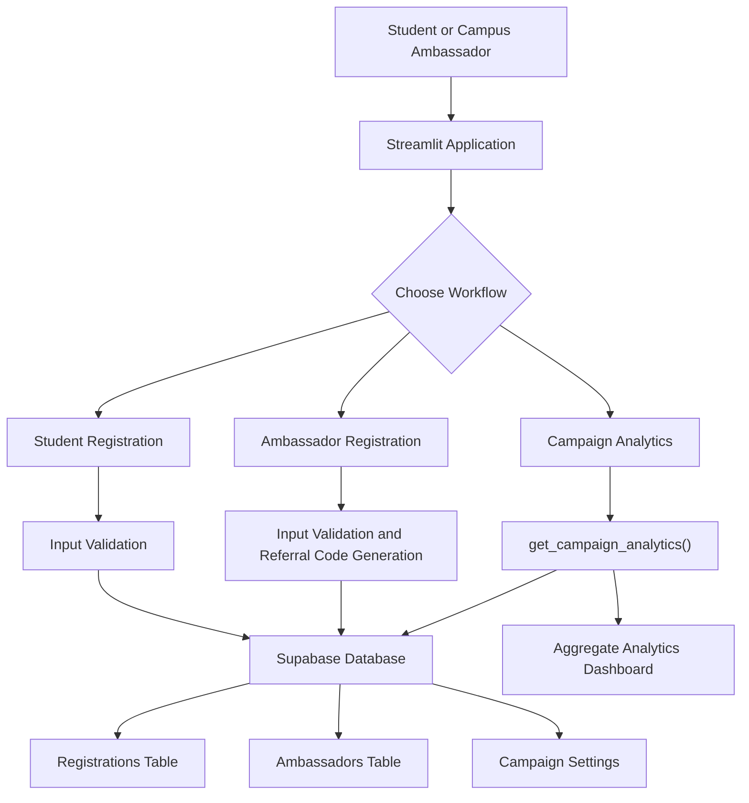

# 🚀 NxtWave Growth Challenge
### Building a measurable growth engine for *Build Your First AI Project in 60 Minutes*

<p align="center">
  <a href="https://nxtwave-growth-challenge-fiiselzqekypyddu7gc6xz.streamlit.app/">
    
  </a>
  <a href="https://github.com/Ashishh13/nxtwave-growth-challenge">
    
  </a>
</p>

<p align="center">
  
  
  
  
</p>

<p align="center">
  <strong>One growth challenge. One working prototype. One measurable plan.</strong>
</p>

---

## 📌 Table of Contents

- [🎯 The Challenge](#-the-challenge)
- [⚡ Explore the Live Prototype](#-explore-the-live-prototype)
- [💡 The Solution](#-the-solution)
- [📈 Growth Strategy](#-growth-strategy)
- [🧩 Application Features](#-application-features)
- [🏗️ System Architecture](#️-system-architecture)
- [🗃️ Database Design](#️-database-design)
- [🛠️ Tech Stack](#️-tech-stack)
- [💻 Run Locally](#-run-locally)
- [🧪 Testing](#-testing)
- [🔐 Security and Responsible Growth](#-security-and-responsible-growth)
- [🤖 AI-Assisted Learning](#-ai-assisted-learning)
- [📂 Project Structure](#-project-structure)
- [📊 Success Metrics](#-success-metrics)
- [🗺️ Roadmap](#️-roadmap)
- [👨‍💻 Author](#-author)

---

## 🎯 The Challenge

The objective of the NxtWave Growth Challenge is to design a practical strategy to attract **500 final-year engineering students** to a free online workshop:

> **Build Your First AI Project in 60 Minutes**

| Constraint | Target |
|---|---:|
| 🎓 Target audience | Final-year engineering students |
| 📝 Registration goal | 500 students |
| ⏳ Campaign duration | 7 days |
| 💰 Total proposed budget | ₹2,000 |
| 🧪 Supporting deliverable | Working growth-tracking prototype |

The challenge is not simply about generating marketing ideas. It is about connecting audience understanding, distribution, measurable targets, execution planning, and learning into one coherent growth system.

### The core idea

**Make registration easy, give campus networks a reason to share, and measure which channels contribute to the goal.**

> **Important:** The application and growth plan have been prepared as challenge deliverables. The campaign itself has not been executed. The 500-registration figure is a target, not an achieved result, and the channel estimates are planning assumptions rather than validated campaign performance.

---

## ⚡ Explore the Live Prototype

<p align="center">
  <a href="https://nxtwave-growth-challenge-fiiselzqekypyddu7gc6xz.streamlit.app/">
    
  </a>
</p>

The deployed application brings together registration, campus ambassador referrals, and campaign analytics.

### Try the main workflows

<details>
<summary><strong>🎓 1. Student registration</strong></summary>

1. Open the live application.
2. Locate the student registration form.
3. Enter the required details.
4. Indicate final-year eligibility.
5. If you have an ambassador referral code, enter it where requested.
6. Submit the form and inspect the resulting application feedback.

Use test information that you are comfortable storing in the connected database.

</details>

<details>
<summary><strong>🤝 2. Campus ambassador registration</strong></summary>

1. Open the ambassador registration section.
2. Enter the required name, email, and college information.
3. Submit the form.
4. Inspect the generated referral code.
5. Use that code in a test student registration to explore referral attribution.

The referral code provides a way to associate registrations with an ambassador.

</details>

<details>
<summary><strong>📊 3. Campaign analytics dashboard</strong></summary>

Explore the dashboard to inspect the available campaign metrics, including:

- Total registrations
- Registrations by source
- Daily registration activity
- Ambassador-level registration counts
- Progress toward the campaign target

The dashboard uses aggregate analytics returned by the Supabase database function. Actual counts depend on the records currently stored in the connected database.

</details>

<details>
<summary><strong>🧰 4. Campus ambassador toolkit</strong></summary>

The application also provides access to a downloadable campus ambassador toolkit containing outreach templates, campaign guidance, a daily tracker, FAQs, and a success checklist.

It is designed to help make campus outreach more consistent without requiring every ambassador to create campaign materials from scratch.

</details>

---

## 💡 The Solution

This project combines two complementary deliverables.

<details open>
<summary><strong>📄 Deliverable A — A focused growth plan</strong></summary>

The plan defines the audience, channels, seven-day pacing, proposed budget, success metrics, and adjustment rules.

Rather than spreading a small budget across many channels, it concentrates on campus ambassadors and relevant college communities.

</details>

<details open>
<summary><strong>🖥️ Deliverable B — A working growth prototype</strong></summary>

The Streamlit application provides a practical way to collect registrations, generate and use referral codes, and inspect aggregate campaign performance.

Supabase handles persistent data storage and analytics, while Streamlit provides the user interface.

</details>

The two deliverables are designed to work together: the plan explains how registrations could be generated, while the application provides a way to track whether those efforts are producing results.

---

## 📈 Growth Strategy

### Channel allocation

The initial strategy focuses on two channels.

| Channel | Planning assumption | Projected registrations |
|---|---|---:|
| Campus ambassadors | 25 ambassadors × 12 registrations | 300 |
| College communities | 20 communities × 10 registrations | 200 |
| **Total** | | **500** |

These figures describe the proposed growth model. They have not been validated through a completed campaign, and the assumptions may need to change after real outreach begins.

### Why these channels?

**Campus ambassadors**

- Use existing student networks and college relationships.
- Provide a clear referral mechanism.
- Make it easier to distribute workshop information through trusted contacts.
- Help identify which campus networks generate registrations.

**College communities**

- Reach relevant students through appropriate class groups and student communities.
- Reuse concise, consistent workshop messaging.
- Encourage sharing where the workshop is relevant to the audience.
- Compare channel-level results to determine where additional effort is worthwhile.

### Seven-day registration pacing

The following is a proposed cumulative target schedule.

| Day | Daily target | Cumulative target |
|---|---:|---:|
| Day 1 | 25 | 25 |
| Day 2 | 50 | 75 |
| Day 3 | 75 | 150 |
| Day 4 | 90 | 240 |
| Day 5 | 100 | 340 |
| Day 6 | 100 | 440 |
| Day 7 | 60 | 500 |
| **Total** | **500** | **500** |

### Proposed budget

| Allocation | Budget |
|---|---:|
| Ambassador coordination | ₹600 |
| Campus activation materials | ₹500 |
| High-performing channel support | ₹600 |
| Contingency | ₹300 |
| **Total** | **₹2,000** |

This is a proposed allocation, not a record of money spent. Free distribution channels should be used first, with any discretionary spend guided by observed results.

<details>
<summary><strong>🔄 How the campaign would adapt to results</strong></summary>

At the end of each day:

1. Compare actual unique registrations with the cumulative target.
2. Review registration counts by source and ambassador.
3. Identify channels that are generating relevant registrations.
4. Shift outreach effort toward stronger-performing channels.
5. Adjust the message or distribution approach when results are weak.
6. Keep outreach relevant and respectful rather than simply increasing message volume.

The objective is to improve the strategy using evidence instead of assuming that every channel will perform equally well.

</details>

---

## 🧩 Application Features

| Feature | Purpose |
|---|---|
| Student registration | Collect student registration details |
| Final-year eligibility field | Record whether a student identifies as being in the target year |
| Ambassador registration | Register campus ambassadors |
| Referral-code generation | Create a unique code for each ambassador |
| Referral validation | Check a submitted referral code against registered ambassadors |
| Duplicate handling | Handle duplicate email submissions |
| Source attribution | Distinguish ambassador-referred registrations from direct registrations |
| Campaign analytics | Retrieve aggregate registration statistics |
| Daily activity tracking | Inspect registrations by date |
| Ambassador performance | Compare referral-associated registration counts |
| Campaign target settings | Store the target, budget, and duration |
| Downloadable toolkit | Provide outreach templates and campaign guidance |

---

## 🏗️ System Architecture

The following diagram illustrates the main application flow.



### Request and data flow

1. A user interacts with the Streamlit interface.
2. The application validates the submitted information.
3. Registration data is stored in Supabase.
4. Referral codes connect ambassador activity to student registrations.
5. The analytics function returns aggregate metrics.
6. The dashboard displays the available campaign information.

The architecture separates application logic from persistent storage, allowing the interface and data operations to be maintained independently.

---

## 🗃️ Database Design

The prototype uses Supabase with three principal tables and an analytics function.

### 1. `ambassadors`

Stores campus ambassador records.

| Column | Purpose |
|---|---|
| `id` | UUID primary key |
| `full_name` | Ambassador name |
| `email` | Unique email address |
| `college` | College name |
| `referral_code` | Unique ambassador referral code |
| `created_at` | Record creation timestamp |

### 2. `registrations`

Stores student registration records.

| Column | Purpose |
|---|---|
| `id` | UUID primary key |
| `full_name` | Student name |
| `email` | Unique email address |
| `college` | College name |
| `is_final_year` | Final-year eligibility field |
| `referral_code` | Optional reference to an ambassador |
| `source` | Registration source, such as `ambassador` or `direct` |
| `created_at` | Record creation timestamp |

### 3. `campaign_settings`

Stores the campaign's target and planning constraints.

| Column | Purpose |
|---|---|
| `id` | Integer primary key, constrained to `1` |
| `registration_target` | Target registration count |
| `budget_inr` | Proposed campaign budget |
| `duration_days` | Campaign duration |
| `updated_at` | Last update timestamp |

### 4. `get_campaign_analytics()`

A PostgreSQL function returns aggregate analytics, including:

- Total registrations
- Registrations by source
- Daily registrations
- Registrations attributed to ambassadors

The function is configured to return summary information rather than exposing student details through the analytics response.

---

## 🛠️ Tech Stack

| Technology | Role |
|---|---|
| **Python** | Application logic and validation |
| **Streamlit** | Interactive web interface |
| **Supabase** | Database and backend services |
| **PostgreSQL** | Persistent relational data storage |
| **python-dotenv** | Local environment variable loading |
| **pytest** | Automated unit testing |
| **Git and GitHub** | Version control and project hosting |
| **Streamlit Community Cloud** | Application deployment |

---

## 💻 Run Locally

Want to explore the code or run the prototype on your own machine? Follow the steps below.

### Prerequisites

- Python 3.12 recommended
- Git
- A Supabase project
- Access to the project's database schema and required analytics function

### Step 1 — Clone the repository

```bash
git clone https://github.com/Ashishh13/nxtwave-growth-challenge.git
cd nxtwave-growth-challenge
```

### Step 2 — Create a virtual environment

**Windows PowerShell**

```powershell
py -3.12 -m venv .venv
.\.venv\Scripts\Activate.ps1
```

If Python 3.12 is already your default Python installation, you can use:

```powershell
python -m venv .venv
.\.venv\Scripts\Activate.ps1
```

### Step 3 — Install dependencies

```bash
python -m pip install --upgrade pip
pip install -r requirements.txt
```

### Step 4 — Configure environment variables

Create a `.env` file in the project root.

```dotenv
SUPABASE_URL=your_supabase_project_url
SUPABASE_KEY=your_supabase_publishable_key
```

Replace the placeholder values with your own Supabase project URL and publishable key.

The application must use the same variable names expected by `src/db.py`. If the names in your local source differ, follow the names defined there.

<details>
<summary><strong>🔐 Important environment-variable guidance</strong></summary>

- Never commit `.env` to GitHub.
- Never place a Supabase service-role key in frontend code or other publicly accessible configuration.
- Use a publishable key for client access, with appropriate database permissions and Row Level Security policies.
- Do not disable Row Level Security simply to make the application work.
- Keep privileged database operations on a trusted server-side boundary.

</details>

### Step 5 — Launch the application

From the project root:

```bash
python -m streamlit run src/app.py
```

Streamlit will provide a local URL, typically:

`http://localhost:8501`

Open that address in your browser.

### Step 6 — Configure the database

The application expects the Supabase tables and analytics function documented in the [Database Design](#️-database-design) section.

If setting up a new Supabase project, recreate the required schema, constraints, function, grants, and Row Level Security policies before testing the registration workflows.

The repository's current schema should be treated as the reference for exact SQL definitions and access policies.

---

## 🧪 Testing

The project includes unit tests for ambassador and student registration validation.

Run the complete test suite from the repository root:

```bash
python -m pytest -v
```

The test suite has previously passed **6 tests** covering validation and referral-code behavior in the development environment.

This is a record of the tests previously run, not a guarantee that every deployment or database integration scenario is covered.

### What should be tested before broader use?

- [ ] Valid student registration
- [ ] Invalid or incomplete student details
- [ ] Duplicate student email
- [ ] Valid ambassador registration
- [ ] Referral-code uniqueness
- [ ] Valid referral-code attribution
- [ ] Invalid referral code
- [ ] Dashboard analytics after a new registration
- [ ] Supabase connectivity and configuration
- [ ] Appropriate handling of failed database requests

---

## 🔐 Security and Responsible Growth

A growth tool should make registration easy without treating student information carelessly.

### Current safeguards and design choices

- Input validation for registration fields
- Duplicate-email handling
- Referral-code validation
- Database-level uniqueness constraints
- Row Level Security enabled in Supabase
- Aggregate analytics for dashboard reporting
- Environment-based configuration for database access

### Improvements needed before wider public use

The prototype still needs additional production-hardening work, including:

- Rate limiting and abuse prevention for public registration endpoints
- Email verification, if required by the final registration process
- Appropriate controls against automated or fraudulent submissions
- Clear privacy information and a defined data-retention policy
- Further review of database permissions and public RPC access
- End-to-end testing under realistic traffic and failure conditions

**Responsible outreach principles**

- Share the workshop with relevant student communities.
- Be accurate about what the workshop offers.
- Avoid misleading claims or artificial urgency.
- Respect community rules and requests not to receive further messages.
- Measure useful registrations, not just message volume.

---

## 🤖 AI-Assisted Learning

AI was used as a support tool throughout the challenge—not as a substitute for decision-making.

The learning process focused on three areas:

<details>
<summary><strong>📈 1. Turning an objective into a growth plan</strong></summary>

**Objective:** Reach 500 registrations in seven days with a ₹2,000 budget.

**Approach:** Break the target into channel assumptions, daily checkpoints, budget allocations, and measurable outcomes.

**My learning:** A growth plan becomes more actionable when its assumptions are explicit and its progress can be measured.

</details>

<details>
<summary><strong>🧑‍💻 2. Turning the plan into a working application</strong></summary>

**Objective:** Build a demonstrable asset rather than submitting only a written strategy.

**Approach:** Develop a Streamlit application backed by Supabase, with registration forms, referral codes, and aggregate analytics.

**My learning:** A working prototype can make a strategy measurable, but it cannot prove that the campaign will succeed without real-world testing.

</details>

<details>
<summary><strong>🧭 3. Evaluating AI suggestions critically</strong></summary>

**Objective:** Choose practical outreach methods under tight budget and time constraints.

**Approach:** Prioritize relevant campus networks, distinguish projected outcomes from actual results, and account for respectful outreach and abuse prevention.

**My learning:** AI can help generate options, but the final decision must reflect the audience, constraints, evidence, and ethical considerations.

</details>

For the full prompt-to-suggestion-to-decision examples, see [`docs/AI_LEARNING_LOG.md`](docs/AI_LEARNING_LOG.md).

For the detailed growth strategy, see [`docs/GROWTH_PLAN.md`](docs/GROWTH_PLAN.md).

---

## 📂 Project Structure

```text
nxtwave-growth-challenge/
│
├── src/
│   ├── __init__.py
│   ├── app.py
│   ├── db.py
│   ├── ambassadors.py
│   ├── registrations.py
│   └── analytics.py
│
├── tests/
│   ├── test_ambassadors.py
│   └── test_registrations.py
│
├── docs/
│   ├── PROJECT_LOG.md
│   ├── DECISIONS.md
│   ├── RESEARCH.md
│   ├── TESTING.md
│   ├── AI_LEARNING_LOG.md
│   ├── SUBMISSION_NOTES.md
│   ├── GROWTH_PLAN.md
│   └── CAMPUS_AMBASSADOR_TOOLKIT.md
│
├── deliverables/
│   └── NxtWave_Growth_Plan.pptx
│
├── .gitignore
├── requirements.txt
└── README.md
```

This structure separates the application, validation logic, tests, supporting documentation, and submission deliverables.

---

## 📊 Success Metrics

The dashboard and campaign plan are designed around measurable indicators.

| Metric | Why it matters |
|---|---|
| Total unique registrations | Measures progress toward the 500-registration target |
| Daily registrations | Shows whether the campaign is keeping pace |
| Registrations by source | Helps compare distribution channels |
| Registrations by ambassador | Helps identify productive campus networks |
| Budget used | Helps monitor spending against the ₹2,000 limit |
| Cost per registration | Can be calculated once actual spending and registration results are available |
| Final-year eligibility | Helps assess whether registrations match the intended audience |

### How success should be evaluated

A complete campaign evaluation should compare actual registrations with the original target, examine channel performance, and account for spending and audience relevance.

Until the campaign is executed, the target and projected channel numbers remain assumptions.

---

## 🗺️ Roadmap

The following are potential next steps for improving the prototype.

- [ ] Execute a small pilot with real students and consent-based outreach.
- [ ] Compare actual channel performance against the initial assumptions.
- [ ] Add rate limiting and stronger abuse prevention.
- [ ] Evaluate email verification and duplicate-submission controls.
- [ ] Add campaign export functionality for reporting.
- [ ] Improve conversion reporting when traffic and funnel data are available.
- [ ] Refine the growth plan using observed registration and cost data.
- [ ] Add broader integration and end-to-end tests.

---

## 👨‍💻 Author

**Ashish Singh**

B.Tech — Computer Science and Engineering, Artificial Intelligence and Machine Learning

- 🐙 **GitHub:** [Ashishh13](https://github.com/Ashishh13)
- 💼 **LinkedIn:** [Ashish Singh](https://www.linkedin.com/in/ashish-singh-82311639a/)
- 🚀 **Live Prototype:** [NxtWave Growth Challenge](https://nxtwave-growth-challenge-fiiselzqekypyddu7gc6xz.streamlit.app/)

---

<p align="center">
  <strong>Build → Measure → Learn → Improve</strong>
  <br>
  Made for the NxtWave Growth Challenge.
</p>

<p align="center">
  <sub>Growth targets are projections until validated by real campaign results.</sub>
</p>